# Ember Roast: coffee-shop ordering app prototype

A high-fidelity, clickable prototype of the single-store coffee-shop app described in the *Coffee Shop Mobile App PRD*. It covers the full customer journey (PRD §4): splash, onboarding, phone sign-in, menu, customization, cart, checkout, simulated payment, live order tracking, history, rewards and profile.

- **Placeholder brand.** "Ember Roast Coffee" is a stand-in name, palette and logo. Swapping in the client's brand only touches a few files (see [How to rebrand](#how-to-rebrand)).
- **Production stack.** Expo SDK 57, expo-router, React Native 0.86 (New Architecture), Reanimated 4, TypeScript strict. This is not a throwaway mock-up: Phase 3 builds on this code.
- **No backend yet.** Menu, orders, points and sign-in run on a mock data layer stored on the device. No SMS is sent and no money moves. Phase 4 swaps the data layer for Supabase without touching screens ([docs/SUPABASE_PLAN.md](docs/SUPABASE_PLAN.md)).
- **Runs on** iOS and Android (Expo Go) and in a web browser.
- **Market: India.** One café in Indiranagar, Bengaluru. Prices are whole rupees (₹250, ₹1,250, Indian digit grouping), GST (5%) is added at checkout, and sign-in uses Indian mobile numbers (+91). All of it is configured in `src/theme/brand.ts`.

**Features added for the Indian launch (round 4)**, all simulated on the device like the rest of the prototype:
- **UPI-first payments.** Google Pay, PhonePe, Paytm and BHIM, plus **Pay with UPI ID**, come first. Each one gets a mock "Approve ₹X" step with a 5:00 countdown, and you can cancel or decline and retry. After UPI come saved Visa and RuPay cards, cash on delivery and pay at the counter.
- **Tip and packaging.** Pickup, In-Car and Delivery orders add ₹15 packaging, with GST on it. Delivery orders can add a tip for the delivery partner: ₹10, ₹20, ₹30 or Other, up to ₹500. The tip is never taxed and earns no points.
- **GST invoice.** Paid orders get a tax invoice sheet. It shows the CGST and SGST split, SAC 996331, the amount in words and the UPI reference. The GSTIN and FSSAI numbers are placeholders.
- **Veg / egg / non-veg marks** on every product, plus a **Veg only** switch on Menu, Category and Search that the app remembers.
- **Favourites.** Tap the heart on a product to save it. Saved items show a heart on their card, Home gets a **Your favourites** rail, and there's a Favourites screen.
- **Indian address form.** House / flat, building, street, landmark, area and a 6-digit PIN code (a Bengaluru PIN fills in the city and state). You can save it as Home, Work or Other, order for someone else, and edit or remove saved addresses.
- **Tilt-to-move.** On product detail, the cut-out moves a little with the phone. On web it follows the mouse.
- **Live order pill.** While an order is in progress, a pill floats over Menu, Rewards and Profile with a filling cup and a countdown. Tap it to open tracking.
- **Dark mode.** Settings → Preferences → **Appearance** offers System, Light and Dark. System, the default, follows the phone.
- **Crisp haptics.** A short list of haptic types, each with one meaning ([docs/HAPTICS.md](docs/HAPTICS.md)). Settings → Preferences → **Haptics** turns them off.

<p>
  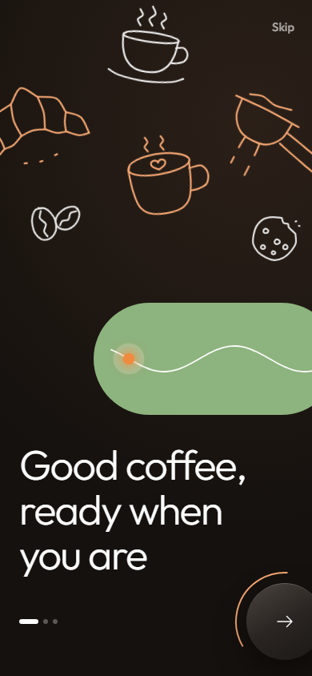
  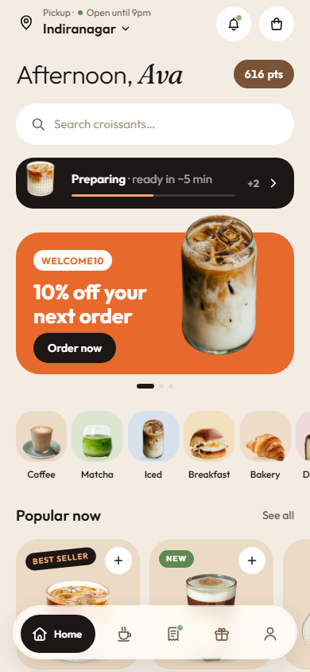
  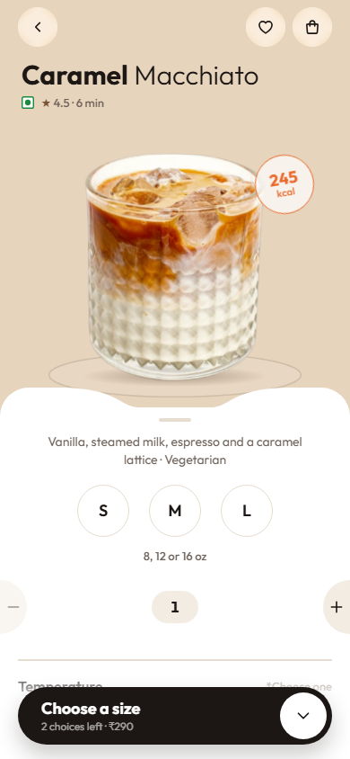
  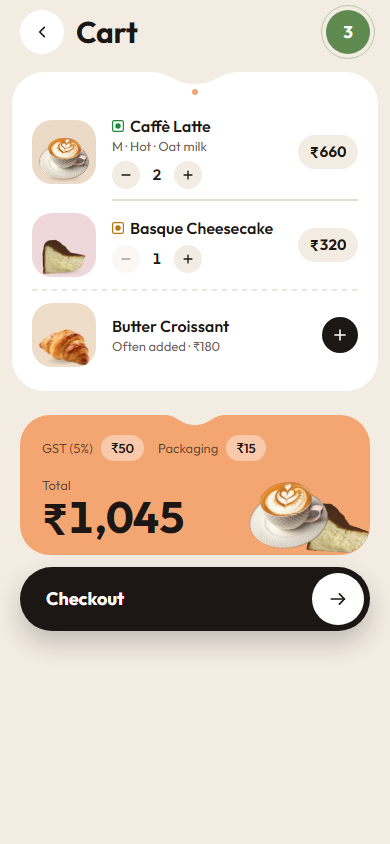
  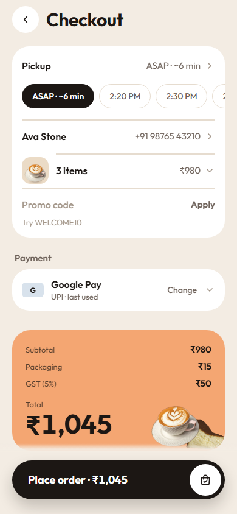
  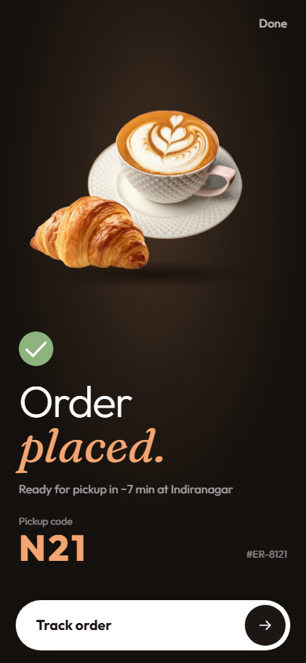
  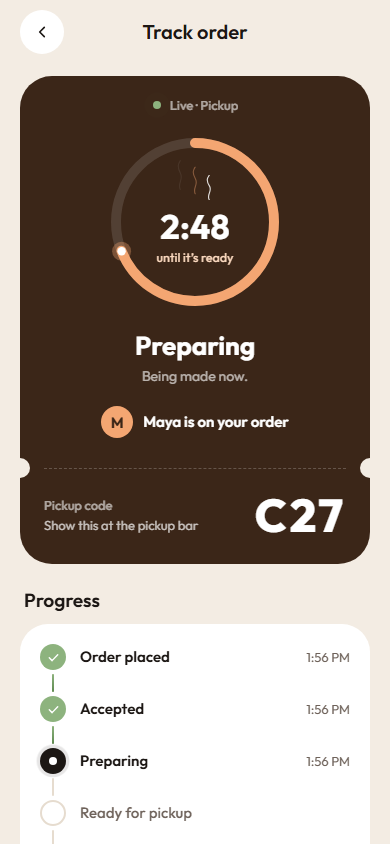
  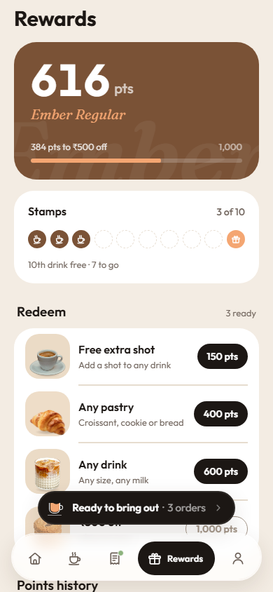
</p>

**Round 4 features:**

<p>
  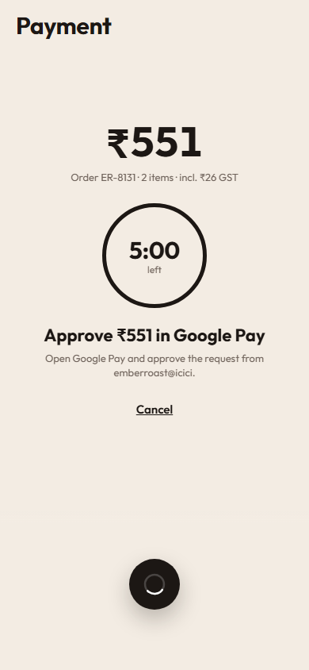
  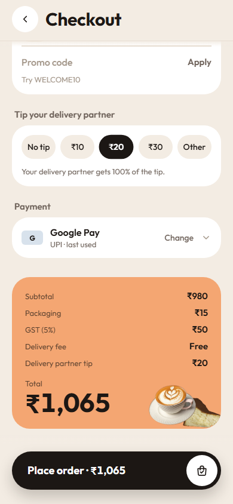
  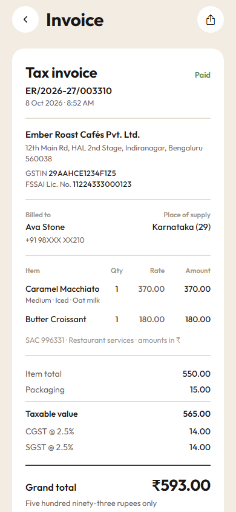
  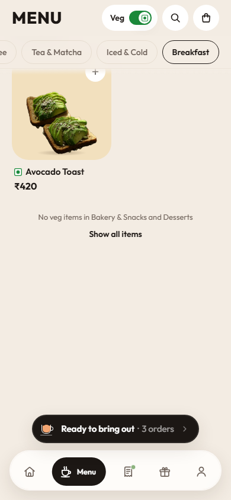
  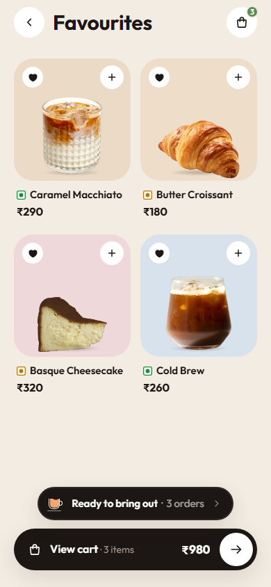
  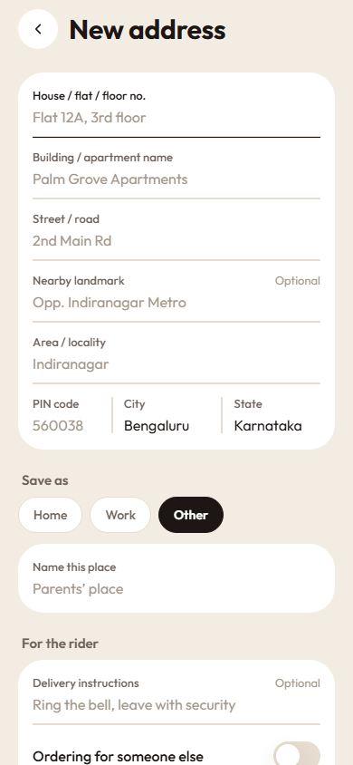
  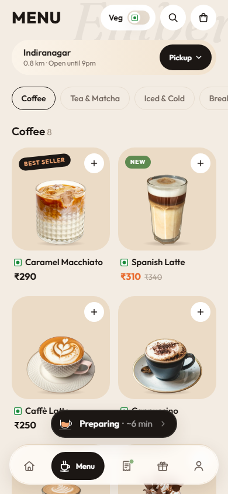
  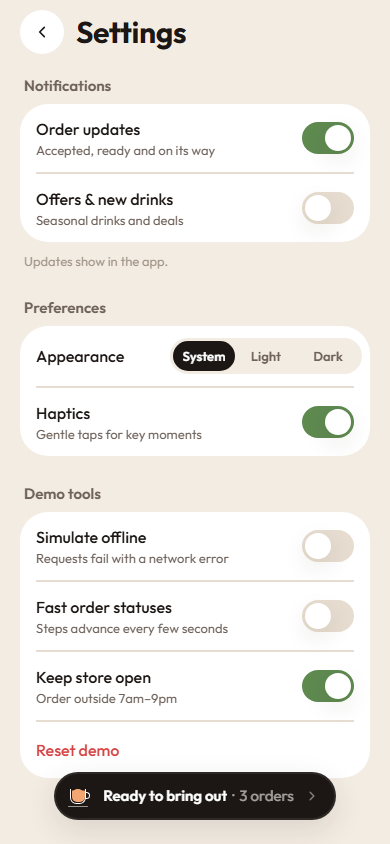
</p>

**Dark mode:**

<p>
  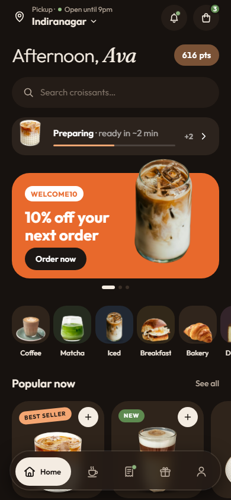
  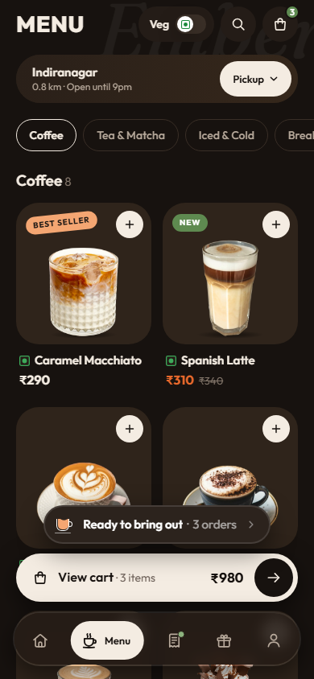
  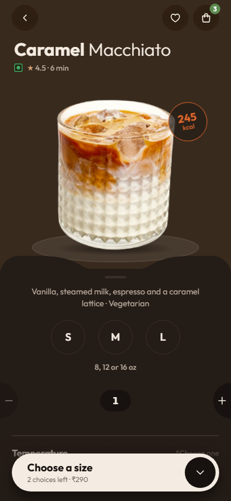
  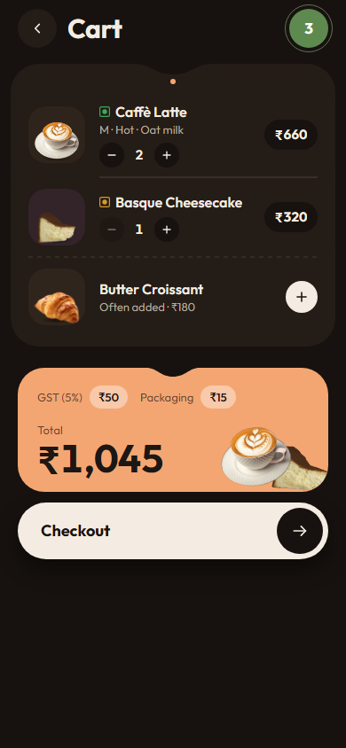
  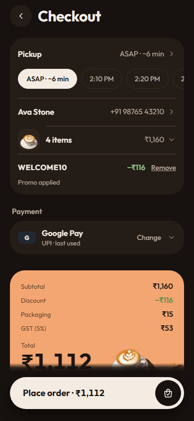
  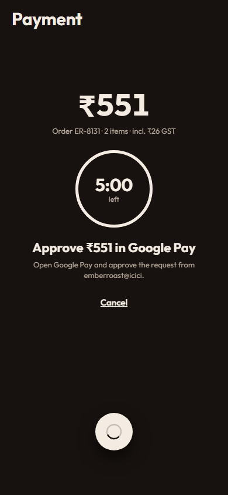
  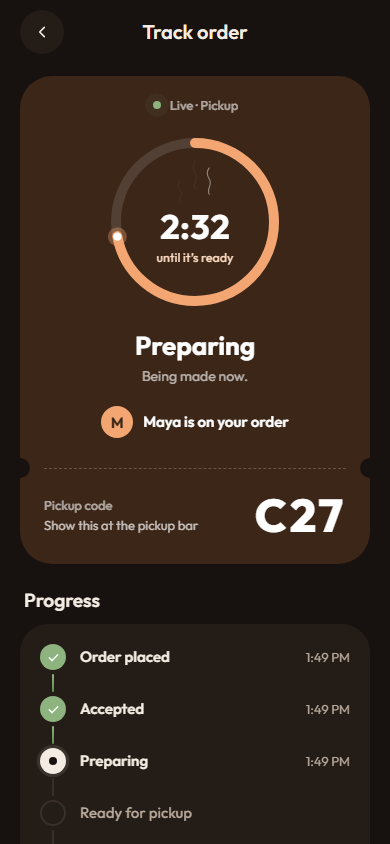
  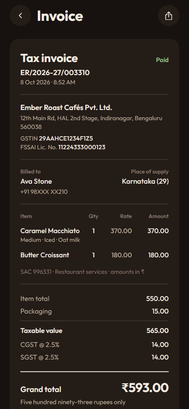
  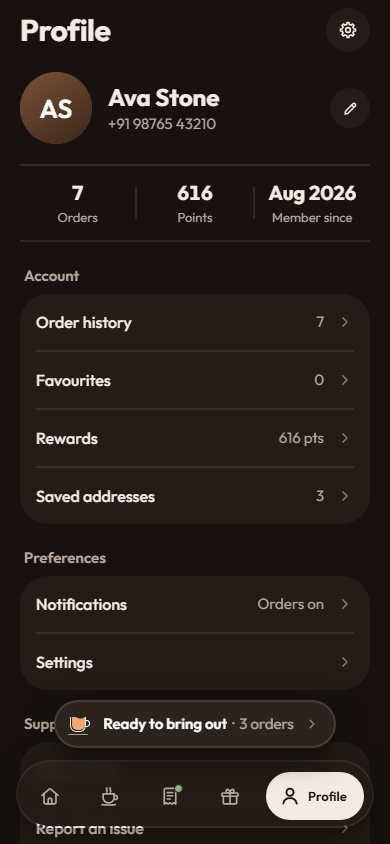
</p>

All screenshots were taken from the web build at 390×844, with INR / +91 data. [`docs/screenshots/`](docs/screenshots/) has 84 light screenshots:
- `01`–`21`: the PRD journey, screen by screen;
- `30`–`38`: one order from quick-add to tracking;
- `22`–`28`: the round 4 features (Veg only, favourites, tip and payment methods, UPI / cash payment, receipt and invoice, the address form, the live order pill).

[`docs/screenshots/dark/`](docs/screenshots/dark/) has 9 of the main screens in dark mode.

**Other docs:** [DESIGN.md](DESIGN.md) (visual and motion spec) · [docs/BUILD_CONTRACT.md](docs/BUILD_CONTRACT.md) (architecture contract and integration notes) · [docs/SUPABASE_PLAN.md](docs/SUPABASE_PLAN.md) (Phase 4 backend plan) · [docs/CLIENT_DECISIONS.md](docs/CLIENT_DECISIONS.md) (PRD §28 open questions) · [docs/research/](docs/research/) (verified API notes).

---

## Quick start

You need Node.js (current LTS) and, for a phone, the **Expo Go** app for SDK 57.

```bash
npm install
npx expo start
```

- **Phone:** scan the QR code. On Android use the Expo Go app's scanner; on iOS use the Camera app. The phone and computer must be on the same network. If the network blocks it, run `npx expo start --tunnel`.
- **iOS Expo Go (SDK 57) requires a login on both sides.** Run `npx expo login` in the terminal and sign in to the **same** Expo account inside the Expo Go app, otherwise the project won't open.
- **Web:** press `w` in the running terminal, or start with `npx expo start --web`. For the intended look, open the browser's device toolbar at a phone size (for example 390×844).
- **Works offline.** Every image is bundled with the app: transparent product cut-outs in `assets/products/` and four banner photos in `assets/scenes/`. Nothing loads from the network.

The first launch shows onboarding. App state (sign-in, cart, orders, points) is saved on the device and survives reloads. **Settings → Demo tools → Reset demo** starts over.

---

## Demo script

This script walks through the PRD §26 acceptance criteria in order, with the exact taps. It takes about 10 minutes. The last section adds the edge states from PRD §24.

### Before the meeting (2 minutes)

1. Sign in once (steps 1 to 4 below), then go to **Profile → Settings** (the gear icon, top right).
2. Under **Demo tools**:
   - turn **Fast order statuses** on, so a placed order plays out in about 15 seconds instead of real prep times;
   - leave **Keep store open (demo)** on (the default), so ordering works at any hour.
3. Tap **Reset demo → Reset everything**. The app returns to onboarding. Both switches above keep their setting through a reset; **Simulate offline** is switched off by it.
4. Under **Preferences**, leave **Haptics** on. Set **Appearance** for the room: **System** follows the phone, while **Light** or **Dark** fixes it for the whole demo. Both keep their setting through a reset. To show dark mode during the meeting, switch it here; the app repaints in place.

### Demo values

| What | Value | Result |
|---|---|---|
| Phone number | any 10-digit Indian mobile (starts with 6, 7, 8 or 9), e.g. `98765 43210`. The **IN +91** chip is fixed; a pasted `+91` or leading `0` is dropped | "Send code" enables once the number is valid. Ten digits starting 0–5: "Indian mobile numbers start with 6, 7, 8 or 9" |
| OTP | `123456` (or tap **Use demo code 123456**) | Signs in. Any 6-digit code except `000000` works |
| OTP | `000000` | "That code isn't right. Try again." The boxes shake, clear and turn red |
| OTP | wait 2 minutes | "This code has expired." with a **Send new code** action. Resend unlocks after 30 s |
| Coupon | `WELCOME10` | 10% off |
| Coupon | `EMBER100` | ₹100 off orders of ₹500 or more. Below that: "Add ₹X more to use this code." (the old `EMBER5` is gone) |
| Coupon | `FIRST20` | 20% off up to ₹150, **first order only**. Works on a new account's first real order (the seeded demo history doesn't count). After you place one order it's refused with "This code is for your first order only." and Home switches its banner to WELCOME10 |
| Coupon | `SUMMER25` | "This code has expired." |
| Coupon | anything else | "We couldn't find that code." |
| Address | **Home** (Flat 4B, Sunrise Residency, 6th Cross, near Domlur Flyover, Domlur, 1.2 km) and **Work** (Level 3, Prestige Tower, Residency Rd, Ashok Nagar, 3.8 km) (saved) | Inside the 5 km delivery range |
| Address | **Nandi Hills cottage** (saved) | Out of the 5 km delivery range: "No delivery to this address yet" |
| Address | a new or edited address whose **Area / locality** (or **City**) contains "Nandi" or "Mysuru" (or "Mysore") | Also out of range. Any other typed address lands within range (in its neighbourhood when the area or PIN is one the app knows). The **PIN code** is required, 6 digits, not starting with 0; a Bengaluru PIN (560001–560103) fills in **City** and **State** |
| UPI ID | `ava@okicici` (any name@bank) | "Request sent to ava@okicici", then the approval countdown. `ava` alone is refused at **Place order**: "Add your bank handle after @, like name@okicici." |
| Payment | **Simulate a failed payment** (under the pay button) | "Payment declined", no money taken, **Retry · ₹X** |
| Delivery tip | ₹10, ₹20, ₹30, or **Other** ₹1–₹500 | Added after GST, never taxed, no points. An empty or out-of-range Other: "Tip ₹1–₹500 or choose No tip" |
| Sold-out item | **Iced Peach Tea** (Iced & Cold) | "Sold out" tile; detail shows "Back tomorrow at 7am" and a "Try instead" rail |
| Unavailable option | **Coconut milk** | Greyed out, "Unavailable" |

A new account starts with a 150-point welcome bonus and two past orders (a Caramel Macchiato with a croissant, and two lattes with a cheesecake), so Order again, order history, the stamp card and rewards all have content. Those orders come to ₹635 (pickup: ₹590 + ₹15 packaging + ₹30 GST, paid with Google Pay) and ₹987 (dine-in, no packaging: ₹940 + ₹47 GST, paid with the Visa), worth 127 + 197 points at 1 point per ₹5, so the account opens with 474 points: enough for "Free extra shot" (150) and "Any pastry" (400). Seeded orders don't count as "last used", so checkout starts on Google Pay.

**Prices at a glance (₹, GST extra):** Espresso 160 · Americano 190 · Cappuccino 230 · Flat White 240 · Caffè Latte 250 · Café Mocha 280 · Caramel Macchiato 290 · Spanish Latte 310 (was 340) · Matcha Latte 320 · Chai Latte 210 · Cold Brew 260 · Iced Latte 270 · Iced Peach Tea 220 · Avocado Toast 420 · Bacon & Egg Brioche 360 · Butter Croissant 180 · Banana Bread 190 · Sea Salt Choc Chip Cookie 140 · Basque Cheesecake 320 · Fudge Brownie 220 · Espresso Tiramisu 340 (was 380). Sizes M +30 / L +60, plant milks +40–50, syrups +40, extra shot +50. Delivery ₹40, free from ₹499. Packaging ₹15 per order for Pickup, In-Car and Delivery (not Dine-In), with GST on it. A delivery partner tip (₹10 / ₹20 / ₹30 / Other up to ₹500) is added after GST: never taxed, never discounted, no points.

**Totals:** taxable value = subtotal − discount + packaging; GST 5% on it, rounded to the rupee; total = taxable value + GST + delivery fee + tip. Example: a ₹980 pickup cart → ₹980 + ₹15 packaging = ₹995 → GST ₹49.75 → ₹50 → **₹1,045**.

### Walkthrough (PRD §26)

**1. Open app.** Launch it. The dark splash draws the bean mark and the Ember Roast wordmark, then lifts into onboarding.

**2. Complete or skip onboarding.** Swipe through three pages, or use the big arrow button (bottom right):
- Page 1, "Good coffee, ready when you are".
- Page 2, location: the arrow button opens the system location prompt and moves on. Granting changes the line to "Location on. Indiranagar is 800 m away."; denying shows "Location is off. You can still pick your café by hand." **Not now** (top right) moves on without asking.
- Page 3, alerts: an **Also send offers** switch (off by default) keeps marketing consent separate from order updates (PRD §7). The arrow button opens the system notification prompt and finishes. **Not now** finishes straight away. On web and Android Expo Go there are no system alerts, so the page says that order status shows in the app instead.

**Skip** (top right of page 1) jumps straight to sign-in.

**3. Log in with phone and OTP.**
1. On **What's your number?**, type `98765 43210` (it formats as you type, next to the **IN +91** chip) and tap **Send code**.
2. On **Enter the code**, type `123456` or tap **Use demo code 123456**. The code verifies automatically.
3. The first time a number signs in, **What should we call you?** asks for a name (required) and an email (optional). Tap **Continue**.

A returning number skips the profile step and goes straight to Home (PRD §5).

**4. Reach Home.** Point out:
- the header: the store block ("Pickup · Open until 9pm" over "Indiranagar ⌄", which is also the ordering-mode switch), the bell and the cart;
- the greeting ("Afternoon, Ava") and the points pill;
- the search bar;
- the live-order strip (only while an order is in progress);
- the promo carousel, which advances every 5 s;
- the category tiles, **Popular now** and **Order again** (one tap re-adds a past order);
- the floating tab bar (Home · Menu · Orders · Rewards · Profile).

**5. Choose an ordering mode.** Tap the store name at the top of Home (or **Pickup ⌄** on Menu) to open the **Order type** sheet:
- **Pickup:** choose **ASAP · ~N min** or a 10-minute slot under "When should it be ready?".
- **Dine-In:** pick a table or area (required).
- **In-Car:** enter make and model, colour and plate.
- **Delivery:** choose an address (step 12).

Tap **Confirm**. Checkout's first row opens the same sheet.

**6. Browse a category.** Tap the **Coffee** tile. The category screen has filter chips (for Coffee: All · Iced · Dairy-free · Low cal). The Hot, Iced, Dairy-free and Low cal chips only appear when they narrow that category's list. The **Menu** tab shows every category with sticky chips.

**7. Open a product.** Tap **Caramel Macchiato**. The cut-out flies from the card into the hero.

**8. Select required and optional customizations.**
1. The bar reads **Choose a size · 2 choices left · ₹290**. Tap it once: the sheet scrolls to the sizes, they shake and "*Choose a size" turns ember.
2. Pick **M**. The ink fill slides between the circles.
3. Choose **Iced** under Temperature.
4. Tap **Milk** (it shows "Whole milk ⌄") and choose **Oat milk**. Coconut milk shows as unavailable.
5. Tap **Syrup** and add **Vanilla** (optional, up to 2).
6. Optionally tap **Add a note** and type a special instruction ("Extra hot please").

**9. See the price update.** The odometer price rolls ₹290 → ₹320 (M) → ₹370 (oat) → ₹410 (vanilla). The kcal badge next to the cut-out updates too. Change the quantity with − / + and the total follows.

**10. Add to cart.** Tap the **₹410 · Add to cart** bar. The cut-out arcs into the cart icon, the badge pops and the bar flashes "Added to cart". Go back and tap **+** on a food card (for example the Butter Croissant): food adds in one tap, while drinks open the detail screen because a size is required.

**11. Edit the cart.** Tap the cart icon to open **Cart**, then:
- **+ / −** to change quantities;
- tap a line to edit it; the bar reads **Update item**;
- **swipe left** on a line to remove it (the first row nudges once to show the gesture);
- add the **Often added** upsell with its **+**.

The peach card shows GST (5%) and Packaging (or the delivery fee or savings when they apply) and the Total, rolling as you edit.

**12. Select order details or address.** Tap **Checkout**, then the first row (**Pickup · ASAP**). In the sheet, choose **Delivery**, then **Add a delivery address** (or **Deliver to**).
1. Tap **Nandi Hills cottage**. The "No delivery to this address yet" card explains the 5 km range and offers **Switch to Pickup** or **Choose another**.
2. Tap **Choose another**, pick **Home** (Flat 4B, Sunrise Residency, Domlur), then tap **Deliver here**.

The delivery fee is ₹40, and free from a ₹499 subtotal. You can also try **Use current location**: it opens the address form with the area, PIN code, city and state of the nearest neighbourhood the app knows (simulated, no reverse geocoding), so you only add the flat and building. A GPS fix more than 60 km from the café (outside Bengaluru) is placed next to it, so it works in a demo anywhere else; inside Bengaluru your real position is used, so more than 5 km from Indiranagar honestly shows the no-delivery card. Or tap **Add new address** to type one: house / flat / floor, building, street, an optional nearby landmark ("Near Domlur Flyover"), area, PIN code, city and state, then **Save as** Home, Work or Other (with your own name), delivery instructions, and **Ordering for someone else** (their name and +91 mobile). Errors show inline when you tap **Save address**. The pencil on a saved address edits it; **Remove address** at the bottom of the form deletes it after a confirm (removing the selected address selects the next one we deliver to). Back with unsaved changes asks before discarding them.

**13. Reach checkout.** One sheet holds the order type, your name and phone (tap to edit), the items (tap to expand) and the promo code. In **Promo code**, try `SUMMER25` (expired), then `EMBER100` (minimum spend ₹500), then `WELCOME10` (applied, shown as "WELCOME10 · −₹x" with **Remove**). For Delivery, **Tip your delivery partner** offers No tip (default), ₹10, ₹20, ₹30 and Other (₹1–₹500). **Payment** is one row with the method you used last (a new account: **Google Pay**); tap it (**Change**) to see every way to pay, UPI first: Google Pay, PhonePe, Paytm, BHIM (text with a tinted monogram, no logos) and **Pay with UPI ID** (type e.g. `ava@okicici`; anything that isn't name@bank is refused at Place order), then Visa •••• 4242, RuPay •••• 6011 and **Add new card** (simulated, no card details), then **Cash on delivery** (Delivery) or **Pay at the counter** (Pickup, Dine-In, In-Car). There is no Apple Pay. The peach card at the end shows Subtotal, Discount, Packaging, GST (5%), Delivery fee, Delivery partner tip and Total. Tap **Place order · ₹X**. If something is missing, such as no table for Dine-In or no UPI ID, the row shakes and scrolls into view.

**14. Simulate payment.** The payment screen shows the amount and the chosen method.
- **UPI (Google Pay, PhonePe, Paytm, BHIM):** tap **Pay ₹X**. "Opening Google Pay…" (under a second), then **Approve ₹X in Google Pay** with a 5:00 countdown ring, the café's UPI ID `emberroast@icici` and **Cancel**. About 2 s later the ring turns sage ("Approved in Google Pay"), the bank confirms and the pay button turns into a check. **Cancel** backs out ("Payment cancelled", no money taken). **Pay with UPI ID** says "Request sent to ava@okicici" instead.
- **Simulate a failed payment** runs the same flow and declines it: the button shakes into **Retry · ₹X**, and "Payment declined" ("No money was taken…") appears with **Change payment method** (back to checkout with the method list open).
- **Cards:** the Visa or RuPay card (or a blank demo card for Add new card); the pay button morphs into a spinner ("Talking to your bank…"), then into a check.
- **Cash on delivery / Pay at the counter:** **Confirm order**; nothing is charged in the app.

The order is only marked paid after the approval (PRD §14); paid UPI orders carry a simulated 12-digit UPI reference and a transaction id.

**15. See order confirmation.** A dark circle grows from the button into the confirmation screen, which shows:
- the ordered items as cut-outs with confetti, a drawn check and **Order placed.**;
- the ETA ("Ready for pickup in ~N min at Indiranagar");
- the **Pickup code** (e.g. N21) and the order number (#ER-1234);
- **Track order**, plus **Done** (top right) to go home.

**16. View order status.** Tap **Track order**. **Track order** shows:
- the countdown ring, the barista line ("Maya is on your order") and the big pickup code;
- the **Progress** timeline, which only shows the steps for this mode.

With Fast order statuses on, it moves Order placed → Accepted → Preparing → Ready for pickup → Completed in about 15 seconds. Points land when it completes. **Cancel order** is offered while the order is Placed or Accepted.

**17. View order history and profile.**
- **Orders** tab: the **Active** and **Past** segments. Tap a past order for **Order details** (progress, items, receipt, payment) and **Reorder**. Paid or completed orders have **View GST invoice**: a "Tax invoice" sheet with the seller (Ember Roast Cafés Pvt. Ltd., placeholder GSTIN 29AAHCE1234F1Z5 and FSSAI number), the invoice number (ER/2026-27/004827 from order ER-4827), place of supply Karnataka (29), the items with SAC 996331, the taxable value split into CGST 2.5% + SGST 2.5%, packaging, delivery fee, the untaxed tip, the grand total in words ("Five hundred thirty-six rupees only") and the UPI reference. The share button sends a text version (a browser without Web Share copies it).
- **Profile** tab: the name and phone, the stats row, **Order history**, **Favourites**, **Rewards**, **Saved addresses**, **Notifications**, **Settings**, **Help & FAQ**, **Report an issue**, **Terms & privacy** and **Log out**.

### More scenes (PRD §24 states and the remaining modes)

| Scene | Taps |
|---|---|
| **Redeem a reward** | **Rewards** tab → balance, tier and stamp card → under **Redeem**, tap the **400 pts** pill on "Any pastry" (the cost is the button). A perforated ticket with a redeem code opens: "Applied to your next order". Tap **Done**. Checkout now shows the reward chip. It needs a pastry in the basket (the chip says "Add a pastry to use this reward" until then). Points are deducted when payment succeeds and refunded if the order is cancelled. **Remove from my next order** is on the ticket |
| **In-car "I'm here"** | Tap the store name on Home → **In-Car** → type a car (e.g. "Hyundai Creta", "White", "KA 03 MN 4521") → **Confirm** → add a drink → **Checkout → Place order → Pay → Track order**. The order holds at **Ready to bring out** and an **I'm here** bar slides up. Tap it: "Thanks! A barista is bringing it out." The order completes a few seconds later |
| **Dine-In** | Store name on Home → **Dine-In** → pick **Patio** (or any table) → order. Status reads "Coming to your table". Pay at the counter is available |
| **Pay at the counter** | At checkout (Pickup, Dine-In or In-Car) open **Payment → Change**, choose **Pay at the counter** → **Place order** → **Confirm order**. The order is confirmed unpaid; the confirmation line ends with "· pay at the counter" |
| **Cash on delivery** | In Delivery, **Payment → Change → Cash on delivery** → **Place order** → **Confirm order** ("Pay on delivery"). The order is confirmed unpaid |
| **UPI ID** | **Payment → Change → Pay with UPI ID**, type `ava@okicici` (try `ava` first: "Add your bank handle after @…") → **Place order** → **Pay**: "Request sent to ava@okicici", then the approval countdown. The next checkout remembers it |
| **Tip** | In Delivery, tap **₹20** under **Tip your delivery partner**: "Delivery partner tip ₹20" joins the peach card and the total. **Other** opens a ₹ field (₹1–₹500). The tip is stored with the order and shown on the invoice as not taxed |
| **GST invoice** | **Orders → Past →** the Caramel Macchiato order → **View GST invoice**. The receipt above it lists every line (packaging, GST, any tip) and the payment method. The invoice shows the seller with placeholder GSTIN and FSSAI numbers, CGST + SGST, the total in words and the UPI reference. The share button (top right) sends it as text |
| **Network error** | **Settings → Simulate offline** on. Home shows a "You're offline" card (tap to retry), Menu shows the offline state with a retry, and Place order explains that the cart is saved. Turn it off to recover |
| **Empty states** | Remove every cart line: "Your cart is empty" with a **Browse menu** button and a "Popular right now" rail. Search for `pizza`: "Nothing for “pizza”", suggestion chips and a "Popular right now" rail. On a fresh account, **Orders** opens on Past; tap **Active** to see "No active orders" |
| **Search** | Tap the search bar → popular searches (Latte, Cold brew, Dairy-free…) → type `dairy free` to match dietary tags |
| **Veg / egg / non-veg marks** | Every card, list row and product title carries the Indian diet mark: green square + dot (veg), amber square + dot (contains egg), brown square + triangle (non-veg, the Bacon & Egg Brioche). **Menu → Veg** (the switch beside search) keeps only veg items: Bakery & Snacks and Desserts drop out and a note at the end names them, with **Show all items**. The same switch sits in every Category's top bar (Desserts: "No veg items here"; Breakfast: "1 veg item · from ₹420" with the avocado toast as its hero) and on Search results (search `brownie`: "The one match contains egg." → **Show all results**). The setting is remembered |
| **Favourites** | Open any product → the heart beside the cart (it pops, and clicks on a phone). Favourited items show a small heart on their card (tap it to remove), Home's **Popular now** becomes **Your favourites** (→ **See all**), and **Profile → Favourites** lists them. A different number signing in starts with none; Reset demo clears them |
| **Live order pill** | Place an order (Fast order statuses on), tap **Done** on the confirmation, then open **Menu**, **Rewards** or **Profile**: a small ink pill floats above the tab bar (above **View cart** when the cart has items) with a cup that fills as the order moves on, "Preparing · ~4 min" counting down, and "2 orders" when there are more (it leads with the soonest; a ready order first). It pops with a peach ring at each status change. Tap it for tracking; swipe it sideways or down to hide it until the next status change. It stays away from Home and Orders (they already show the order live), tracking, the ordering flow (product, cart, checkout, order type, address, payment, confirmation), while the keyboard is open and while a sheet such as the reward ticket is open. Lists under it get extra room at the end, so their last row scrolls clear of it |
| **Tilt the product** | On a phone, open any product and tip it gently: the cut-out shifts and turns a few degrees against the tilt while its shadow slides the other way, so it looks lifted off the plate. Hold still and it eases back to centre within a few seconds, whatever angle you hold the phone at. The category hero's cut-out drifts the same way, more quietly. On web the mouse does it instead. Off under Reduce Motion |
| **Product unavailable** | **Menu → Iced & Cold → Iced Peach Tea** |
| **Location / notifications denied** | Deny the system prompts during onboarding. An inline note explains what still works. **Use current location** on the address screen falls back to the manual form |
| **Cancel an order** | Turn Fast order statuses off first (a longer window) → place an order → **Track order → Cancel order → confirm**. The order moves to Past as Cancelled, with refund copy |
| **Reorder** | **Home → Order again → Reorder**, or **Orders → Past → Reorder**. Sold-out items are skipped and named in the toast |
| **Log out / returning user** | **Profile → Log out** → sign in with the same number. No profile step, straight to Home |
| **Haptics** | On a phone, haptics mark meaning, not touches (see [docs/HAPTICS.md](docs/HAPTICS.md)): a crisp tick for choices, steppers and OTP digits, a click on switches, a soft landing when an item reaches the cart, and `success` only for real outcomes (payment, a verified code, an applied coupon or redeemed reward, an order that's ready). Navigation taps are silent. **Settings → Preferences → Haptics** turns them off (it keeps its setting through Reset demo) |
| **Dark mode** | **Settings → Preferences → Appearance → Dark**: the app repaints in place (espresso canvas, lifted tiles, a cream primary bar and tab pill, dark toasts and live pill). **Light** switches back; **System** (the default) follows the phone's light / dark setting. The choice survives Reset demo |
| **Start over** | **Settings → Reset demo → Reset everything** |

---

## Feature map vs the PRD

| PRD section | Where in the app | Status |
|---|---|---|
| §4 Customer journey | Splash → `onboarding` → `auth/*` → `(tabs)` → `product/[id]` → `cart` → `checkout` → `payment` → `order/confirmation/[id]` → `order/[id]` → `(tabs)/orders` | Done |
| §5 Authentication | `auth/phone`, `auth/otp` (resend timer, expiry, invalid / expired / offline errors), `auth/profile` (name required, email optional); returning users skip setup | Simulated: no SMS, codes are mocked |
| §6 Location & permissions | Onboarding page 2; `address` → Use current location; deliverability by distance; manual address form; deny or skip supported | Done (single store, so no "nearest store") |
| §7 Notification onboarding | Onboarding page 3: separate Order updates and Promotions switches; Settings → notification prefs | Done. Local notifications on iOS Expo Go and dev builds; none on web or Android Expo Go (in-app toasts instead) |
| §8 Home | `(tabs)/index`: store header (also the mode switch), bell, cart, greeting, points, search, live-order strip, promos, categories, Popular now (Your favourites once there are any), Order again | Done |
| §9 Ordering modes | `mode` sheet + `ModeCards`: Dine-In (table / area), Pickup (ASAP or slot), In-Car (car details + I'm here), Delivery (address + range check) | Done |
| §10 Menu | `(tabs)/menu`, `category/[id]` (filters), `search`; cut-out photos, prices, dietary tags, veg / egg / non-veg marks and a "Veg only" switch, best-seller / new stickers (at most one per card), sold-out state, favourites (`favorites`) | Done |
| §11 Customization | `product/[id]`: reusable modifier groups, required / optional, single / multi, min / max, option prices, live price, quantity, instructions, snapshot stored with the line | Done |
| §12 Cart | `cart`: quantities, edit line, swipe to remove, GST, delivery fee, savings, total, upsell (the coupon field is at checkout) | Done |
| §13 Checkout | `checkout`: order type, address or pickup / table / car, contact, summary, coupon and reward, payment method, total, Place order | Done |
| §14 Payments | `payment`: UPI apps and UPI ID (approval countdown, cancel, decline), cards, cash on delivery, pay at the counter; failure and retry; not marked paid until approved; GST invoice (`order/invoice/[id]`) | Simulated: no gateway |
| §15 Order status | `order/[id]`: mode-specific flows (delivery uses Out for delivery, the others Ready), cancel while Placed / Accepted | Simulated: an on-device simulator advances statuses |
| §16 Order history | `(tabs)/orders` (Active / Past), `order/[id]` (receipt, reorder, help) | Done |
| §17 Loyalty | `(tabs)/rewards`: balance, tier, stamp card, rewards, redeem ticket, points history (how to earn lives in the Help FAQ) | Done (mock data); the stamp card is display-only |
| §18 Profile | `(tabs)/profile`, `address` (add, edit and remove saved addresses), `settings`, `help`, `legal` | Done |
| §19 Bottom navigation | `(tabs)/_layout` + `components/navigation/TabBar` | Done: Home · Menu · Orders · Rewards · Profile |
| §20 Admin dashboard | n/a | Not in prototype: Phase 6, outline in [SUPABASE_PLAN.md](docs/SUPABASE_PLAN.md#11-admin-dashboard-nextjs) |
| §21 Recommended backend | `src/api` seam, ready to swap | Not in prototype: Phase 4 |
| §22 Database entities | Mirrored by `src/types/models.ts` | Modeled; tables in [SUPABASE_PLAN.md](docs/SUPABASE_PLAN.md) |
| §23 Prototype screens | All 23: splash = `components/onboarding/AnimatedSplash`; location + notification onboarding = `onboarding` pages 2–3; Settings / Help = `settings` + `help` | Done |
| §24 UI states | Loading skeletons, empty cart / search, sold out, permission denied, invalid / expired OTP, missing customization, payment failed, offline, order placed, no delivery | Done (see [More scenes](#more-scenes-prd-24-states-and-the-remaining-modes)) |
| §25 Design | [DESIGN.md](DESIGN.md): own identity, photography, motion; light and dark (Settings → Appearance; System follows the phone, §R4) | Done |
| §26 Acceptance criteria | [Demo script](#walkthrough-prd-26) | Done |
| §27 Out of scope | Driver GPS, driver app, marketplace, AI recommendations, BI | Not built (by design) |
| §28 Client decisions | [docs/CLIENT_DECISIONS.md](docs/CLIENT_DECISIONS.md) | Open |

Route paths are relative to `src/app/`.

---

## Architecture overview

```
src/
  app/              expo-router routes (every file is a screen; _layout.tsx files are navigators)
    _layout.tsx     root Stack: fonts, store hydration, splash, simulator, auth guards (Stack.Protected)
    (tabs)/         Home · Menu · Orders · Rewards · Profile
    auth/           phone, otp, profile
    product/[id]    category/[id]    order/[id]    order/confirmation/[id]
    cart  checkout  payment  mode  address  search  favorites  settings  help  legal  onboarding
  api/              THE data seam: index.ts (async API), hooks.ts, mockDb.ts, simulator.ts
  data/mock/        menu.ts, modifiers.ts, marketing.ts (promos, coupons, rewards, addresses, FAQ), photos.ts
  store/            zustand stores: session.ts, cart.ts, demo.ts, favorites.ts (favourites + Veg only), hydration.ts
  lib/              pure logic: pricing, modifiers, orderFlow, geo, storeHours, format, pickupCode, haptics, notify, location
  components/
    ui/             design-system primitives (Text, Icon/LineIcon, PressableScale, buttons, PrimaryBar, fields)
    motion/         motion kit (OverlayHost: toasts + fly-to-cart, RollingNumber, LineArt, Confetti, MorphPayButton, FrostedLayer…)
    domain/         commerce components (ProductCard, CartButton, FloatingCartBar, ModeCards, OrderStatusCard, States…)
    navigation/     floating TabBar
    onboarding/ home/ product/ checkout/ account/   screen-group components
    order/          the live order pill (mounted once by the root layout) and its rules
  theme/            index.ts (design tokens), palette.ts (light + dark colours), theming.tsx (ThemeProvider, useTheme,
                    makeStyles), appearance.ts (System / Light / Dark), brand.ts (brand + store config)
  types/models.ts   domain types, named after the PRD §22 entities
```

**Routing and auth.** `src/app/_layout.tsx` uses `Stack.Protected` guards on session state:
- not onboarded → only `onboarding`;
- onboarded but signed out → `auth/*`;
- signed in → the app.

`legal` is reachable from every state. Flipping a guard redirects automatically, so screens don't call `router.replace` for sign-in and sign-out.

**Data seam (`src/api`).** Screens read and write data only through `src/api/index.ts`, for example:
- auth: `sendOtp`, `verifyOtp`, `saveProfile`;
- catalog: `getMenu`, `getProductSync`, `searchProducts`, `getPromotions`, `getRewards`;
- coupons and delivery: `validateCoupon`, `checkDelivery`;
- orders: `createOrder`, `payOrder`, `cancelOrder`, `markArrived`.

Live data comes from `src/api/hooks.ts`: `useMyOrders`, `useActiveOrders`, `useOrder`, `useLoyalty`, `useCartReward`. Every async call waits about 450 ms, so skeletons show, and throws `NetworkError` when Simulate offline is on. Phase 4 replaces the function bodies with Supabase calls and keeps the signatures; the full mapping is in [docs/SUPABASE_PLAN.md](docs/SUPABASE_PLAN.md).

**Mock DB and simulator.**
- `src/api/mockDb.ts` is a persisted zustand store standing in for the server: profiles, orders, loyalty, the OTP session, and simulator due times.
- `src/api/simulator.ts` stands in for the café dashboard plus Realtime. It advances paid orders through their mode's status flow (`STATUS_FLOW` in `src/lib/orderFlow.ts`) on the same timeline as the ETA. In-car orders wait at Ready until "I'm here". It awards points on completion and fires local notifications, plus a `success` haptic only when an order is ready (delivered, for delivery orders).

**Client stores (`src/store`).** All persist with AsyncStorage (localStorage on web), under the keys `ember.session.v2`, `ember.cart.v2`, `ember.demo.v2` and `ember.mockdb.v2` (`STORAGE_KEYS` in `src/lib/storage.ts`; v2 is the INR / +91 data model, so a device that ran the earlier USD build starts fresh instead of reading $5.20 as ₹5; the old v1 keys are deleted after the first v2 hydration, `purgeLegacyStorage()`):
- `session`: onboarding, permissions, notification prefs, phone and profile, ordering mode and details, addresses, recent searches, and the device preferences Haptics and Appearance;
- `cart`: lines with modifier snapshots, coupon, reward; identical configurations merge;
- `demo`: the Demo tools switches.

**Motion system.** Everything animates on the UI thread with Reanimated 4 worklets and Gesture Handler. Shared values use `sv.get()` / `sv.set()`, and JS callbacks go through `scheduleOnRN`.
- Spring presets live in `src/theme/index.ts` (`springs.snappy / smooth / gentle / bouncy`, all `mass: 1`).
- The reusable pieces are in `src/components/motion`: entrance builders (`enterUp`, `riseEntrance`), toasts, fly-to-cart, the odometer, line-art draw-on, confetti, the morphing pay button and frosted headers.
- Reduce Motion swaps movement for quick fades.
- React Compiler is on.

[DESIGN.md](DESIGN.md) §7 is the spec; [docs/research/reanimated4.md](docs/research/reanimated4.md) has the verified API rules.

**Theme and brand files.**
- `src/theme/index.ts`: spacing, radii, fonts, type scale, springs, and the runtime theme. Colours, tile / hero tints and shadows exist per scheme in `src/theme/palette.ts` (light = R3, dark = DESIGN.md §R4); components read them at render time with `useColors()` / `useTheme()` or `makeStyles((c) => …)`, so Settings → Appearance re-themes the app in place. The recipe for converting a screen is in [docs/BUILD_CONTRACT.md](docs/BUILD_CONTRACT.md) → Theming.
- `src/theme/brand.ts`: name, tagline, currency (`INR`, `₹`, `en-IN`, 0 decimals) with `formatMoney` / `roundMoney`, GST rate and label, support contacts, store details (address, coordinates, hours, delivery radius and fee, tables) and loyalty rates.
- Money is whole rupees end to end: every computation goes through `roundMoney` (half up to `currency.decimals`), `formatMoney` prints "₹1,250" / "₹1,25,000" (Indian grouping done by hand, since Hermes without full ICU groups the Western way), and `RollingNumber money` takes its prefix and decimals from `brand.currency`. Phone helpers (`formatPhone`, `displayPhone`, `isValidPhone`, `nationalPhone`) are in `src/lib/format.ts`; numbers are stored as the bare 10 digits and shown as "+91 98765 43210".
- `src/data/mock/photos.ts`: every product and banner image, as `local:<key>` strings that `photoSource.ts` resolves to the bundled files.

---

## How to rebrand

1. **Brand and store config:** `src/theme/brand.ts`. This covers the name, full name, tagline, currency (code, symbol, locale, decimals), GST rate and label, support phone and email, and store details: name, address, coordinates, `opensAtHour` / `closesAtHour`, delivery radius, fee and free-delivery threshold, and the table list. It also sets the loyalty rates. The splash, onboarding lockup, store card, legal copy and pricing all read from here.
2. **Visual tokens:** `src/theme/index.ts`.
   - Change the hex values in `lightColors` / `darkColors` and the tile and hero tints in `src/theme/palette.ts` (both schemes). Keep the token names: `ember`, for example, is the accent role, not the color; DESIGN.md §R4 lists what each role is for and its contrast target.
   - For new fonts, load them in `src/app/_layout.tsx` (`useFonts`) and point `fonts` at the new family names. Use one family per weight and never set `fontWeight`.
3. **Imagery:** replace the files in `assets/products/` (one transparent cut-out per key, square, subject centred with its base near the bottom edge; see DESIGN.md §R3 A4) and `assets/scenes/`, keeping the file names, or add keys in `src/data/mock/photos.ts` and `photoSource.ts`. Per-item placement fixes live in `src/data/mock/photoMetrics.ts`. `CATEGORY_PHOTOS` in `src/data/mock/menu.ts` picks each category tile's photo.
4. **Menu and marketing data:**
   - `src/data/mock/menu.ts` for categories and products;
   - `src/data/mock/modifiers.ts` for modifier groups and their attachments;
   - `src/data/mock/marketing.ts` for promotions, coupons, rewards, seed addresses, payment methods and the FAQ.
5. **App shell:**
   - `app.json`: `name`, `slug`, `scheme`, the splash and adaptive-icon background colors;
   - the icon and splash images in `assets/images/` (`icon.png`, `splash-icon.png`, `android-icon-*.png`, `favicon.png`). They currently show a placeholder Ember Roast mark: a peach line-art bean on espresso.
6. **Leftover copy:** search the source for the literal text `Ember Roast`. That finds a few captions, the loyalty tier names in `src/components/account/format.ts`, and the `EMBER100` coupon.

---

## Tests and checks

```bash
npm test               # Jest (jest-expo): 39 suites, 433 tests
npx tsc --noEmit       # strict type-check (also: npm run typecheck)
npx expo lint          # ESLint (eslint-config-expo): 0 errors; the warnings are require() calls inside jest mocks and a few deliberate mount-only effect deps
npm run theme:check    # files still on the static light palette (empty now; `-- --strict` fails if any come back)
npx expo-doctor        # dependency and config health
```

The tests cover pricing (whole-rupee GST with packaging, coupon and points rounding checked for every subtotal up to ₹20,000, the untaxed tip), payment methods and UPI ID validation, the UPI hand-off on the payment screen, the GST invoice (CGST/SGST split, amount in words, invoice numbers), coupons, modifier rules, +91 phone parsing, deliverability around the café, the v2 storage keys, the order flow and simulator timeline, order ownership and loyalty, and render or interaction tests for every screen group. Test files live in `__tests__` folders next to the code, never under `src/app/` (every file there is treated as a route).

Typed routes are generated by `npx expo start`. To check hrefs without a dev server, see "Typed routes without a dev server" in [docs/BUILD_CONTRACT.md](docs/BUILD_CONTRACT.md).

---

## Known limitations (prototype-only behaviour)

**Data and accounts**
- **No backend.** All data lives on the device, so orders are not shared between devices or people. Menu changes need code edits; there is no admin dashboard yet.
- **Sign-in is simulated.** No SMS is sent. Any 6-digit code except `000000` signs in. Only Indian mobile numbers (+91, 10 digits starting with 6–9) are accepted.
- **Favourites and the Veg only switch live on the device** (`ember.favorites.v2`): favourites belong to the number that saved them, aren't synced, and the diet marks are placeholder assumptions the client must confirm (see [docs/CLIENT_DECISIONS.md](docs/CLIENT_DECISIONS.md#other-decisions-the-prototype-surfaced)).
- **New accounts are seeded** with a welcome bonus and two past orders, so history and "Order again" have content. Seeded orders are flagged (`demoSeed`) and don't count as a first order, so `FIRST20` works until the customer places a real order.

**Payments and orders**
- **Payments are simulated.** UPI apps, UPI IDs, cards and cash are placeholders: no app opens, no collect request is sent and no gateway is called. The approval lands by itself a few seconds after "Approve in …"; UPI references and transaction ids are made up. App names are shown as text with a monogram, never their logos.
- **GST is a flat 5% on the discounted subtotal plus packaging**, outside the delivery fee and the tip, rounded to the rupee. Prices are shown GST-exclusive. The GST invoice is a mock-up: the GSTIN and FSSAI numbers are placeholders and it says "Prototype — not a valid tax invoice".
- **Statuses are simulated.** An on-device simulator moves orders forward while the app is open, and catches up when it reopens. There is no staff side.
- **Store hours.** The store is open 7am–9pm. "Keep store open (demo)" is on by default; with it off, ASAP ordering is refused outside those hours and the slot chips offer tomorrow.

**Delivery and location**
- **Delivery range is a straight-line 5 km radius** from the café's coordinates (12th Main, Indiranagar; the café itself is fictional). Typed addresses aren't geocoded: an area or PIN code from the app's short list of neighbourhoods around Indiranagar (`LOCALITIES` in `src/lib/geo.ts`) places the address there, anything else lands within 3 km of the café, and an area or city containing "Nandi" or "Mysuru" (also "Mysore") lands 24–38 km out. "Use current location" names the nearest of those neighbourhoods instead of reverse geocoding, and a GPS fix more than 60 km away (outside Bengaluru) is moved near the café.

**Rewards**
- **The stamp card is display-only.** It shows one stamp per completed order; no free drink is issued yet.

**Platform**
- **Notifications are local only.** They show on iOS (Expo Go or a dev build) when permission is granted. Web and Android Expo Go use in-app toasts. There is no push yet.
- **Web differences.** There are no native screen transitions, the mode sheet opens as a full page, and haptics are off. Deep links are restored after sign-in on web only. Tilt-to-move follows the mouse on web (nothing on touch-only browsers); on phones it reads the motion sensors without a permission prompt and stays still where they're missing.
- **Android.** Card shadows need Android 9 or newer. With 3-button navigation, Android draws its own contrast band over the dark screens (changing it needs the `expo-navigation-bar` package).
- **Large system text** is capped at 1.2×, so fixed-height pills and bars don't clip.
- **Dark mode** covers every screen (`npm run theme:check -- --strict` passes), and **System** follows the phone (`FOLLOW_SYSTEM_SCHEME` in `src/theme/appearance.ts`). It has been checked in a browser, not yet on a phone. Android doesn't get its native chrome overridden (Expo Go could restart the app), so system dialogs there follow the phone, not the in-app choice.
- **Not yet run on a phone.** The app has been checked screen by screen in the web build, and the iOS and Android bundles build cleanly. The on-device checklist is at the end of [docs/BUILD_CONTRACT.md](docs/BUILD_CONTRACT.md#device-checklist-not-yet-run-on-hardware).
- **Photos** are Unsplash stock photos cut out into transparent product images and bundled with the app. They stand in for the client's own product photography.

**Not built yet**
- The app icon and splash use a placeholder Ember Roast bean mark until the client's logo arrives.
- **Veg marks on checkout and tracking.** Cards, list rows, cart lines and product titles show the veg / egg / non-veg mark; the checkout item list and the tracking / order-details item lines don't yet.

---

## Photo credits

Product and banner photos are from Unsplash, under the free Unsplash License. The products were cut out into transparent WebP images and are bundled with the app, so the demo works offline. The photographers are credited in [docs/research/photos/CREDITS.md](docs/research/photos/CREDITS.md). The production app should use the client's own photography.

---

## Next phases (PRD §29)

| Phase | Scope | Notes |
|---|---|---|
| 1. Design system + hi-fi prototype | This repo | Done |
| 2. Client approval | Run the demo script above, then settle [CLIENT_DECISIONS.md](docs/CLIENT_DECISIONS.md) | Next |
| 3. Build the React Native app | Harden this codebase: final menu and brand, remove demo-only seeding and tools, accessibility pass, development builds via EAS | The prototype already uses the production stack |
| 4. Supabase | Auth (phone OTP), Postgres + RLS, Storage, Realtime | [docs/SUPABASE_PLAN.md](docs/SUPABASE_PLAN.md) |
| 5. Payments + notifications | Chosen gateway, payment webhook edge function, Expo push notifications | Gateway fees are paid by the client (PRD §14, §30) |
| 6. Admin dashboard | Next.js: orders board, menu / modifiers / availability, promos, coupons, reports | Outline in [SUPABASE_PLAN.md](docs/SUPABASE_PLAN.md#11-admin-dashboard-nextjs) |
| 7. Real-device testing | iOS + Android, including a mid-range Android for the performance budget (DESIGN.md §7) | |
| 8. Store deployment | EAS Build / Submit to the App Store and Google Play | Developer accounts owned by the client (PRD §30) |
